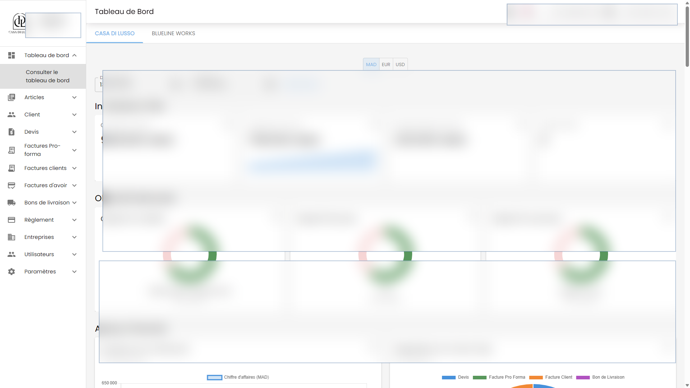
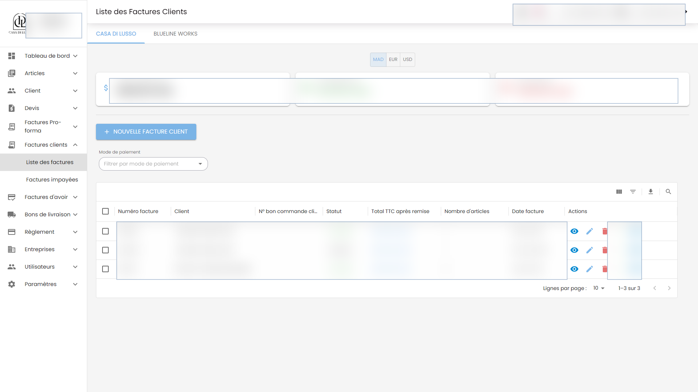

# E.B.H Facturation Frontend

Next.js interface for a billing and operations platform connected to a Django backend. The application covers sales documents, payments, logistics, stock, companies, users and account settings through shared forms, tables and authenticated workflows.

## What It Shows

- An internal business interface with authenticated navigation and permission-aware actions.
- Data-heavy dashboards, lists, filters, create/edit/detail pages and printable documents.
- State management with Redux Toolkit, RTK Query and redux-saga.
- Reusable form controls and module conventions across operational workflows.
- Behavior tests for routes, components, authentication, helpers and API services.

## Key Capabilities

- Login, password recovery and holding SSO integration.
- Clients, articles, article imports and archives.
- Quotes, pro-forma invoices, customer invoices, credit notes, delivery notes and payments.
- Document status changes, conversions, printing, unpaid invoices and uninvoiced delivery notes.
- Logistics orders, suppliers and logistics dashboards.
- Stock balances, receipts, movements and inventories.
- Company and user management, profile editing, password changes and notification preferences.
- Dashboard reporting, monthly objectives and changelog history.
- French/English translations, light/dark appearance and WebSocket notifications.
- Backend-controlled maintenance and application-version update checks.

Available actions depend on backend permissions, company configuration and the signed-in account.

## Stack

- Next.js 16, React 19 and React Compiler
- TypeScript 7 project compiler, ESLint 10, Prettier and Bun
- NextAuth, Axios and React Redux
- Redux Toolkit, RTK Query and redux-saga
- MUI, MUI X Data Grid/Date Pickers, Emotion and Sass
- Formik, Zod and date-fns
- Chart.js and image-cropping controls
- Jest 30, Testing Library, ts-jest and jsdom

`package.json` and `bun.lock` are the source of truth for exact versions. The project compiler is `@typescript/native`; a separate TypeScript package supports tools that depend on its JavaScript API.

## Related Repository

- Backend API: [Altroo/facturation_backend](https://github.com/Altroo/facturation_backend)
- Mobile application: [Altroo/facturation_native](https://github.com/Altroo/facturation_native)

## Screenshots

Redacted production screenshots. Sensitive names, amounts, dates and records are blurred.





## Local Setup

### Requirements

- Bun and a Node.js version compatible with the installed Next.js and ESLint packages.
- A running Django backend and an account with the appropriate permissions.
- Local environment configuration for authentication, API requests and WebSockets.

### Configuration

```bash
bun install --frozen-lockfile
cp -n .env.example .env
```

The example contains deployment-style hostnames. Replace them with your local addresses before starting development; do not assume it points to a local backend.

| Configuration                                                                  | Purpose                                                       |
| ------------------------------------------------------------------------------ | ------------------------------------------------------------- |
| `NEXT_PUBLIC_HTTP_PROTOCOLE`, `HTTP`, `WS`                                     | HTTP and WebSocket scheme configuration                       |
| `NEXT_PUBLIC_BACKEND_DOMAIN`, `NEXT_PUBLIC_BACKEND_API`                        | Hostnames used by the environment template                    |
| `NEXT_PUBLIC_API_ROOT_URL`, `NEXT_PUBLIC_API_ROOT_PORT`, `NEXT_PUBLIC_API_URL` | Backend host, port and API origin                             |
| `NEXT_PUBLIC_ROOT_API_URL`, `NEXT_PUBLIC_ROOT_WS_URL`                          | Browser API and WebSocket roots                               |
| `NEXTAUTH_URL`, `NEXTAUTH_SECRET`, `AUTH_TRUST_HOST`                           | Authentication URL, signing secret and host trust             |
| `NEXT_PUBLIC_DOMAIN_URL_PREFIX`, `ALLOWED_ORIGINS`                             | Deployment path/origin configuration                          |
| Module endpoint variables in `.env.example`                                    | Account, company, document, logistics and other service paths |

For a typical local setup, Next.js runs at `http://localhost:3000`, Django APIs at `http://localhost:8000/api`, and WebSockets at `ws://localhost:8000/ws`. Keep the server-side and browser-facing addresses consistent with your backend.

Generate your own local auth secret, for example with `openssl rand -base64 32`, rather than using the template value. Keep private `.env` files outside Git. Variables beginning with `NEXT_PUBLIC_` are exposed to the browser and must not contain secrets.

### Run

```bash
bun run dev
```

The default local port is `3000`. `bun run debug` starts Next.js with the Node inspector enabled. To verify a production build locally:

```bash
bun run build
bun run start
```

### Project Structure

| Location                                             | Purpose                                                              |
| ---------------------------------------------------- | -------------------------------------------------------------------- |
| `src/app/(auth)/`, `src/app/sso/`                    | Login, password recovery and SSO routes                              |
| `src/app/dashboard/`                                 | Business modules and settings routes                                 |
| `src/app/api/`                                       | Server-side API routes, auth and application-version endpoint        |
| `src/components/pages/`                              | Interactive module screens used by route pages                       |
| `src/components/formikElements/`, `htmlElements/`    | Shared form controls and UI elements                                 |
| `src/components/shared/`, `layouts/`, `portals/`     | Shared module controls, navigation, dialogs and feedback             |
| `src/contexts/`, `src/providers/`                    | Initialization, session, language, theme and toast providers         |
| `src/store/`                                         | Actions, services, sagas, slices and selectors                       |
| `src/models/`, `src/types/`                          | Domain models and shared contracts                                   |
| `src/utils/`                                         | Reusable hooks, API helpers, routes, raw data and validation schemas |
| `src/styles/`, `src/translations/`, `public/assets/` | Styling, translations and public assets                              |

Server Components and API routes handle server-side concerns such as session access. Interactive Client Components own state, forms and browser hooks. Django remains responsible for business data and permission enforcement. NextAuth manages the web session and cookies.

RTK Query services use the shared Axios request layer. Query caching and mutation invalidation keep server data current; initialization effects dispatch actions for account/session state, while sagas coordinate application events and WebSockets. Follow an equivalent existing module before adding another flow.

### Maintenance Commands

| Command           | Purpose                                                                                 |
| ----------------- | --------------------------------------------------------------------------------------- |
| `bun run upgrade` | Update dependency ranges with npm-check-updates; review compatibility before installing |
| `bun install`     | Resolve dependencies and update `bun.lock` after intentional manifest changes           |
| `bun run analyse` | Run Next.js bundle analysis                                                             |
| `bun run debug`   | Start development with the Node inspector                                               |

## Quality Checks

```bash
node node_modules/@typescript/native/bin/tsc --noEmit
bun run lint
bun x jest --runInBand --coverage=false
bun run build
```

Use `bun run test:watch` while developing and `bun run test:coverage` for coverage reports. Keep regression tests beside the code they exercise and verify affected workflows after changing shared components or service contracts.

## Portfolio Note

The repository is public for portfolio review. Screenshots are redacted, and credentials and private runtime configuration are intentionally excluded. The code demonstrates an evolving business application and its shared architecture across operational modules.
